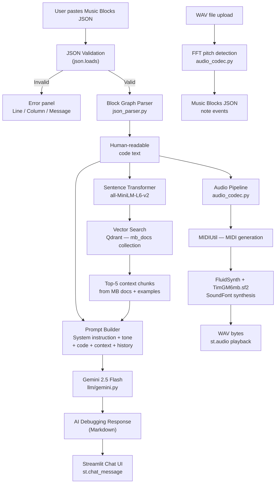
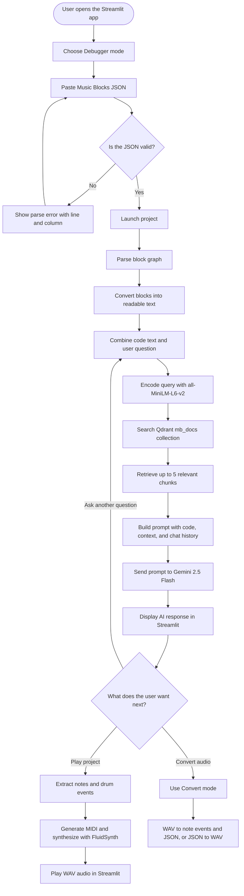

# AI-Powered Debugger for Music Blocks

> An interactive Streamlit application that helps users understand, debug, and extend their [Music Blocks](https://musicblocks.net/) projects using AI assistance, semantic retrieval, and real-time audio synthesis.

---

## Table of Contents

1. [Project Overview](#project-overview)
2. [The Problem](#the-problem)
3. [The Idea](#the-idea)
4. [What the Application Does](#what-the-application-does)
5. [How It Works Internally](#how-it-works-internally)
6. [Architecture Diagram](#architecture-diagram)
7. [End-to-End Workflow](#end-to-end-workflow)
8. [Technology Stack](#technology-stack)
9. [AI and Retrieval Pipeline](#ai-and-retrieval-pipeline)
10. [Application Modules](#application-modules)
11. [Demo](#demo)
12. [Installation and Setup](#installation-and-setup)
13. [Running the Application](#running-the-application)
14. [Example Usage](#example-usage)
15. [Project Structure](#project-structure)
16. [Limitations and Known Issues](#limitations-and-known-issues)
17. [Future Improvements](#future-improvements)
18. [Learning Outcomes](#learning-outcomes)
19. [Author](#author)

---

## Project Overview

Music Blocks is a visual, block-based programming environment designed to help learners create music through code. Users build programs by connecting blocks that represent notes, instruments, rhythms, loops, and actions — and the environment executes those programs as music.

This project extends the Music Blocks experience by providing an AI-assisted development studio. Users paste or compose their Music Blocks JSON projects, validate them, hear them play, and interact with an AI coach that can analyze the code, explain what each block does, and suggest debugging steps or improvements. The application also supports bidirectional conversion between WAV audio and Music Blocks JSON, an interactive virtual instrument suite, a music theory quiz, and a curated learning hub.

---

## The Problem

Music Blocks represents programs as JSON graphs of connected blocks. While the visual interface makes music programming accessible, the underlying JSON format can become complex quickly. A single project might contain dozens of interconnected block references, nested loops, instrument assignments, and pitch specifications — all encoded as nested lists and maps.

When something sounds wrong or does not play at all, the user is left staring at raw JSON with no immediate explanation of what went wrong or which block is causing the issue. There is no built-in error analysis, no human-readable summary of what the program is doing, and no interactive way to ask questions about the code. For beginners and intermediate learners, this gap between writing code and understanding its behavior is a real obstacle.

---

## The Idea

The core idea is to bridge two gaps simultaneously:

1. **Comprehension gap** — translate the JSON block graph into readable prose so that both humans and AI models can reason about what the program actually does.

2. **Debugging gap** — once the code is human-readable, route it through a retrieval-augmented generation (RAG) pipeline so that an LLM can respond with contextually relevant explanations and suggestions, drawing from Music Blocks documentation, example projects, and lesson plans stored in a vector database.

Rather than building a closed-loop autonomous fixer, the application acts as an AI coach: it explains the code, highlights potential issues, answers follow-up questions, and guides users toward solutions. This design reflects a deliberate choice to keep humans in the loop while making the AI genuinely useful.

---

## What the Application Does

The application is organised into five modes, accessible from a navigation bar at the top:

| Mode | What It Does |

|---|---|

| **Debugger** | Paste Music Blocks JSON, validate it, convert it to readable text, play audio, and chat with the AI coach |

| **Convert** | Bidirectionally convert between WAV audio files and Music Blocks JSON |

| **Instrument** | Play individual notes and drum pads, record them, and load the composition into the debugger |

| **Music Theory Quiz** | An eight-question quiz that tests fundamental music theory knowledge |

| **Learning Hub** | Curated external learning resources and interactive virtual instrument demos |

---

## How It Works Internally

### 1. Input Collection and JSON Validation

The user pastes Music Blocks JSON into the **Debugger** text area. Before any processing, the application performs a client-side JSON parse. If the parse fails, it surfaces an error panel showing the exact line number, column number, and error message — similar to the inline error display in a code editor. Valid JSON unlocks the **Launch** button.

### 2. Block Graph Parsing

When the user launches the project, [`JSONParser/json_parser.py`](JSONParser/json_parser.py) traverses the block graph starting from the `start` block. It handles two JSON formats:

- The **native Music Blocks format** — an array of tuples `[id, [type, args], connections]`

- A **simplified blocks dict format** — `{"blocks": {"id": {"block": "...", "connections": [...], ...}}}`

The parser recursively visits each block, resolves its type and arguments, and emits a line of human-readable text. Block types such as `newnote`, `playdrum`, `pitch`, `repeat`, `forever`, `setmasterbpm2`, `action`, `storein2`, `forward`, and many others all produce distinct, descriptive output. The result is a tree-structured text representation of the program.

**Example conversion:**

```

Start Block --> {ID: ..., Position: (0.00, 0.00), Heading: 0°, ...}

├── Set Master BPM → 90 BPM

├── Note

│   ├── Duration --> 1/4 = 0.25

│   ├── Pitch --> Solfege: sol, Octave: 4

├── Note

│   ├── Duration --> 1/4 = 0.25

│   ├── Pitch --> Solfege: mi, Octave: 4

```

### 3. Semantic Retrieval (RAG)

After the code is converted to text, [`retriever/retrieve.py`](retriever/retrieve.py) encodes the combined code text and user question using the `all-MiniLM-L6-v2` sentence-transformer model and queries a **Qdrant** vector database (collection `mb_docs`). The database is pre-populated with Music Blocks documentation, example projects, and lesson plans from the `data/` directory. The top-5 most semantically similar chunks are returned as context.

If Qdrant is unreachable (for example, during local development without a running Qdrant instance), the retriever catches the exception and returns an empty list, allowing the rest of the pipeline to continue without context chunks.

### 4. Prompt Construction

[`app/api.py`](app/api.py) assembles the final prompt from four components:

- A **system instruction** defining the AI's role as a versatile assistant with a Music Blocks context

- A **tone directive** that is curiosity-driven for the first interaction and more direct and action-oriented for subsequent interactions

- The **converted code text** from the block parser

- The **retrieved documentation chunks** from Qdrant

- The **conversation history** from the current session

The same prompt construction logic is replicated in [`app/main.py`](app/main.py) for the Streamlit-native chat path.

### 5. LLM Response via Gemini

[`llm/gemini.py`](llm/gemini.py) sends the assembled prompt to **Google Gemini 2.5 Flash** (`models/gemini-2.5-flash`) with a temperature of 0.7 and a maximum output of 2000 tokens. The module includes an exponential-backoff retry decorator using `google.api_core.retry`, with an initial delay of 1 second, maximum of 10 seconds, and a 30-second deadline. The API key is read from Streamlit secrets first and falls back to the `.env` file.

### 6. Audio Playback

When the user clicks **Play**, [`audio_codec.py`](audio_codec.py) traverses the block graph, extracts the sequence of notes (pitch, octave, duration in beats) and drum events, converts beat positions to seconds using the project BPM (default 120), and builds a timeline array. Each note is rendered through [`audio_instruments.py`](audio_instruments.py), which:

- Generates a MIDI file for the note using `MIDIUtil`

- Calls the bundled **FluidSynth** binary (included in `fluidsynth/bin/`) with the **TimGM6mb.sf2** General MIDI soundfont

- Reads the synthesized WAV back and places it at the correct position in the timeline

The final mixed audio is returned as WAV bytes and played through Streamlit's `st.audio` widget. If FluidSynth is unavailable, the module returns silence rather than raising an unhandled exception.

### 7. Audio ↔ JSON Conversion

The **Convert** mode supports round-tripping:

- **WAV → JSON**: A WAV file is decoded, its pitch is tracked frame-by-frame using FFT peak detection, consecutive frames of the same pitch are merged into note events, and the result is a JSON document containing note name, start time, and duration.

- **JSON → WAV**: A JSON document (either the Music Blocks blocks format or a flat notes list) is converted back to synthesized audio using the same FluidSynth pipeline.

### 8. Chat Interface

The debugger mode exposes a `st.chat_input` component at the bottom of the page. Every user message is appended to `st.session_state.chat_history` and included in the next prompt. The user can export the entire conversation (including the project code and selected instrument) as a plain text file.

### 9. FastAPI Backend

A FastAPI application runs on port 8001 in a daemon thread alongside the Streamlit process (launched from `app/main.py` via `threading.Thread`). Its `/analyze` endpoint mirrors the Streamlit-native chat path and accepts `code`, `prompt`, `history`, and `prompt_count` fields. This endpoint is intended for external or programmatic access.

---

## Architecture Diagram



---

## End-to-End Workflow

The application combines Music Blocks JSON parsing, semantic retrieval, AI-assisted explanation, and audio synthesis. The workflow below summarizes the main debugger path, with separate paths for playback and audio conversion.



### Workflow, Step by Step

1. **Input and validation:** The user pastes a Music Blocks JSON project into Debugger mode. The interface validates the JSON and reports parsing errors before the project is launched.
2. **Block parsing:** `JSONParser/json_parser.py` traverses the block graph and converts supported blocks into a human-readable text representation.
3. **Semantic retrieval:** `retriever/retrieve.py` encodes the converted code and user question with `all-MiniLM-L6-v2`, then queries the Qdrant `mb_docs` collection for the top five matching chunks.
4. **Prompt construction:** The application combines the system instruction, tone directive, converted code, retrieved context, and current conversation history.
5. **AI response:** `llm/gemini.py` sends the prompt to Gemini 2.5 Flash. The resulting explanation or debugging suggestions are displayed in the Streamlit chat interface.
6. **Audio playback:** When the user chooses Play, the audio pipeline extracts notes and drum events, generates MIDI, synthesizes the sound using FluidSynth and `TimGM6mb.sf2`, and returns WAV audio for playback.
7. **Audio conversion:** In Convert mode, WAV audio can be analyzed using FFT-based pitch detection to create note-event JSON. JSON note events can also be synthesized back into WAV audio.

**Retrieval fallback:** If Qdrant is unavailable, the retriever is described as returning an empty context list so the rest of the AI flow can continue without retrieved documentation. The quality of the response may therefore differ when retrieval is unavailable.

*The diagram describes the application behavior documented in this README. Verify each path against the current code before presenting it as a tested end-to-end flow.*

---

## Technology Stack

| Technology | Role in This Project |

|---|---|

| **Python 3.10+** | Primary language for all application and processing logic |

| **Streamlit** | Web UI framework — pages, widgets, session state, chat interface, audio playback |

| **FastAPI + Uvicorn** | Background REST API server providing a `/analyze` endpoint for external access |

| **Google Gemini 2.5 Flash** | LLM for natural language analysis, debugging suggestions, and general Q&A |

| **`google-generativeai`** | Python SDK for calling the Gemini API with retry and safety settings |

| **Qdrant** | Vector database storing pre-embedded Music Blocks documentation and example projects |

| **`sentence-transformers`** | Encodes queries and documents using `all-MiniLM-L6-v2` for semantic similarity search |

| **`python-dotenv`** | Loads environment variables (API keys) from a `.env` file |

| **FluidSynth** | Software synthesizer that renders MIDI files to audio using SoundFont files |

| **TimGM6mb.sf2** | General MIDI SoundFont providing realistic instrument samples for all 14 supported instruments |

| **`MIDIUtil`** | Generates MIDI files programmatically from note and instrument data |

| **NumPy / SciPy** | Signal processing for WAV encoding, decoding, and FFT-based pitch detection |

| **`wave` (stdlib)** | Reading and writing WAV byte streams |

| **`langchain-core`** | Imported as a dependency (present in `requirements.txt` via `langchain-text-splitters`); not directly invoked in the active application paths |

---

## AI and Retrieval Pipeline

The retrieval-augmented generation (RAG) pipeline works as follows:

1. **Document corpus**: The `data/` directory contains Music Blocks documentation (`data/docs/`), a comprehensive guide (`data/guide/guide_MB.md`), and 14 structured lesson plans (`data/lesson plans/`). These were presumably chunked and embedded into the Qdrant collection `mb_docs` during a setup phase (the embedding ingestion script is not included in the repository; see [Limitations](#limitations-and-known-issues)).

2. **Embedding model**: `sentence-transformers/all-MiniLM-L6-v2` — a lightweight but effective bi-encoder model producing 384-dimensional dense vectors.

3. **Vector search**: At inference time, the query (converted code + user message) is encoded and the top-5 nearest neighbours are retrieved from Qdrant by cosine similarity.

4. **Context injection**: Retrieved chunk text is concatenated into the prompt under the heading **"helpful parts from documentation or examples"**, giving the LLM grounding in Music Blocks-specific knowledge without relying solely on its pre-training data.

5. **Graceful degradation**: If Qdrant is unreachable, the retriever logs the error and returns an empty list. The prompt is still assembled and sent to Gemini — it simply lacks the retrieval context.

---

## Application Modules

### `app/main.py` — Streamlit Application

The entry point. Manages the full five-mode UI, session state for chat history, project JSON, recorded notes, and quiz progress. Spawns the FastAPI server in a background daemon thread.

### `app/api.py` — FastAPI Backend

Exposes `/analyze` (POST). Accepts Music Blocks JSON and a user prompt, runs the full parse → retrieve → prompt → Gemini pipeline, and returns the response as JSON.

### `JSONParser/json_parser.py` — Block Graph Parser

Converts Music Blocks JSON (both native array format and the simplified blocks-dict format) into a human-readable, tree-structured text representation. Handles over 20 block types including notes, drums, loops, variables, actions, and turtle graphics blocks.

### `retriever/retrieve.py` — Semantic Retriever

Encodes the query with `all-MiniLM-L6-v2` and queries the Qdrant collection `mb_docs`. Returns the text payloads of the top-5 results.

### `llm/gemini.py` — Gemini Interface

Configures and calls `models/gemini-2.5-flash`. Reads the API key from Streamlit secrets or environment variables. Implements an exponential-backoff retry decorator. Includes a `safe_ask_gemini` wrapper for additional resilience.

### `audio_codec.py` — Audio Conversion

- `audio_to_json()`: WAV bytes → JSON note events via FFT pitch tracking

- `json_to_audio()`: Music Blocks JSON or note-list JSON → WAV bytes via FluidSynth synthesis

### `audio_instruments.py` — Instrument Synthesis

Generates instrument audio using FluidSynth and the TimGM6mb.sf2 SoundFont. Supports 14 instruments mapped to General MIDI program numbers. Falls back to silence if FluidSynth is missing.

### `virtual_instruments_ui.py` — Interactive Instrument UI

Renders clickable HTML/JavaScript instrument interfaces (piano keyboard, guitar strings, drum pads, brass fingering charts) inside Streamlit using `st.components.v1.html`. Notes play in the browser via the Web Audio API.

### `data/` — Knowledge Base

Contains Music Blocks official documentation, example project walkthroughs (Chopsticks, Hot Cross Buns, La Bamba, Silent Night, and others), and 14 lesson plans covering topics such as scales, harmonics, intervals, rhythm geometry, and Frère Jacques. This corpus is the source material for the Qdrant vector database.

---

## Demo


This is a local recording. To share it:

- **GitHub**:https://github.com/Pathemeher07/AI-Powered-Debugger-For-Music-Blocks.

- **YouTube / Loom**:https://youtu.be/uImPbUzGMT0?si=qU6z29p15Y_6peqs.


### Screenshots

| Feature | Screenshot |

|---|---|

| Debugger — JSON input and validation | `docs/screenshots/debuggerUI.png` |

| Debugger — AI coach chat response | `docs/screenshots/debugger_chat.png` |

| Convert — WAV to JSON conversion | `docs/screenshots/convert.png` |

| Instrument — interactive piano pad | `docs/screenshots/instrument.png` |

| Music Theory Quiz | `docs/screenshots/quiz.png` |

| Learning Hub | `docs/screenshots/learning_hub.png` |

| Workspace | `docs/screenshots/workspace.png`|

---

## Installation and Setup

### Prerequisites

- **Python 3.10 or 3.11** (the project was developed and tested on Python 3.10, as evidenced by the `cpython-310` cache files)

- **Git**

- A **Google Gemini API key** (free tier available at [Google AI Studio](https://aistudio.google.com/))

- A **Qdrant** instance — either:

  - [Qdrant Cloud](https://cloud.qdrant.io/) (free tier available), or

  - Local Docker: `docker run -p 6333:6333 qdrant/qdrant`

- The Qdrant `mb_docs` collection must be pre-populated with embeddings from the `data/` corpus (see note in [Limitations](#limitations-and-known-issues))

### 1. Clone the Repository

```bash

git clone https://github.com/Pathemeher07/AI-powered-Debugger-for-Music-Blocks.git

cd AI-powered-Debugger-for-Music-Blocks

```

### 2. Create and Activate a Virtual Environment

```bash

# Windows (PowerShell)

python -m venv .venv

.venv\Scripts\Activate.ps1

# macOS / Linux

python -m venv .venv

source .venv/bin/activate

```

### 3. Install Dependencies

```bash

pip install -r requirements.txt

```

> **Note**: `requirements.txt` includes PyTorch (`torch==2.9.1`) and the full Transformers stack, which makes the initial install large (~2–3 GB). Ensure you have sufficient disk space and a stable internet connection.

### 4. Configure Environment Variables

Create a `.env` file in the project root:

```env

GEMINI_API_KEY=your_gemini_api_key_here

QDRANT_URL=https://your-qdrant-instance-url

QDRANT_API_KEY=your_qdrant_api_key_here

```

Alternatively, configure the Gemini key in `.streamlit/secrets.toml`:

```toml

GEMINI_API_KEY = "your_gemini_api_key_here"

```

> **Security**: Never commit `.env` or `secrets.toml` to version control. Both files are listed in `.gitignore`.

### 5. FluidSynth (Windows — Already Bundled)

The repository includes a pre-built FluidSynth binary for Windows under `fluidsynth/bin/fluidsynth.exe`. On Windows, no additional steps are needed. On Linux or macOS, install FluidSynth via your package manager:

```bash

# Ubuntu / Debian

sudo apt-get install fluidsynth

# macOS (Homebrew)

brew install fluid-synth

```

### 6. Qdrant Collection Setup

> **Important**: The ingestion script that chunks the `data/` documents and uploads embeddings to Qdrant is not included in this repository. To enable the RAG features, you will need to create this script yourself or use the Qdrant web UI to upload embeddings. The collection must be named `mb_docs` with vectors of dimension 384 (matching `all-MiniLM-L6-v2`).

If the Qdrant collection is absent or unreachable, the application continues to function — the AI assistant will respond without retrieval context.

---

## Running the Application

```bash

streamlit run app/main.py

```

The Streamlit app opens at `http://localhost:8501`. The FastAPI backend starts automatically at `http://localhost:8001`.

---

## Example Usage

### Debugging a Music Blocks Project

1. Open the **Debugger** tab.

2. Select an instrument (e.g. **Piano**) from the dropdown.

3. Paste your Music Blocks JSON into the text area. The app immediately validates the JSON and shows any parse errors with line and column information.

4. Click **Launch My Music Blocks Project!** to convert the JSON to readable text.

5. Click **▶️ Play** to hear the synthesized audio.

6. Ask the AI coach a question in the chat input at the bottom, for example: **"Why is my melody jumping by too many octaves?"** or **"How do I add a repeat loop to this?"**

### Converting WAV to JSON

1. Open the **Convert** tab.

2. Select **WAV → JSON**.

3. Upload a WAV file.

4. The app extracts note events and displays the resulting JSON.

5. Click **View in Debugger** to load the result directly into the Debugger.

### Playing and Recording Notes

1. Open the **Instrument** tab.

2. Choose an instrument.

3. Click the note buttons (C4, D4, E4…) or drum pads to play sounds. Each click is recorded.

4. The **Music Workspace** panel at the bottom shows the recorded sequence as Music Blocks JSON in real time.

5. Click **🚀 Load into Debugger** to bring your composition into the Debugger for playback and AI analysis.

---

## Project Structure

```

AI-powered-Debugger-for-Music-Blocks/

│

├── app/

│   ├── main.py                  # Streamlit application entry point (928 lines)

│   ├── api.py                   # FastAPI REST backend (/analyze endpoint)

│   └── __init__.py

│

├── JSONParser/

│   ├── json_parser.py           # Music Blocks JSON → readable text converter

│   └── __init__.py

│

├── llm/

│   ├── gemini.py                # Gemini 2.5 Flash interface with retry logic

│   └── __init__.py

│

├── retriever/

│   ├── retrieve.py              # Qdrant vector search with sentence-transformers

│   └── __init__.py

│

├── embeddings/

│   └── __init__.py              # Placeholder; ingestion script not included

│

├── data/

│   ├── docs/                    # Music Blocks documentation and example projects

│   │   ├── musicblocks_documentation.md

│   │   ├── Chopsticks.md / .pdf

│   │   ├── Hot cross buns ...md / .pdf

│   │   └── ...                  # 12 more example projects

│   ├── guide/

│   │   └── guide_MB.md          # Comprehensive Music Blocks guide

│   └── lesson plans/            # 14 structured music + programming lesson plans

│

├── fluidsynth/

│   └── bin/

│       └── fluidsynth.exe       # Pre-built FluidSynth binary (Windows)

│

├── .streamlit/

│   ├── config.toml              # Streamlit server configuration

│   └── secrets.toml             # API keys (not committed to git)

│

├── audio_codec.py               # WAV ↔ JSON conversion and audio timeline mixing

├── audio_instruments.py         # MIDI + FluidSynth + SoundFont instrument synthesis

├── virtual_instruments_ui.py    # HTML/JS interactive instrument widgets

├── TimGM6mb.sf2                 # General MIDI SoundFont for audio synthesis

├── Debugger-Music-Blocks.mp4    # Local demo recording

├── requirements.txt             # Pinned Python dependencies

├── .env                         # Environment variables (not committed to git)

├── .gitignore

└── README.md

```

---

## Limitations and Known Issues

- **Qdrant ingestion script is missing**: The script that processes and uploads the `data/` corpus into the Qdrant vector database is not included in the repository. Setting up the RAG pipeline requires writing or obtaining this script separately.

- **Streamlit pause and stop controls are cosmetic**: The Pause and Stop buttons in the Debugger display informational messages, but Streamlit does not support live audio control. Audio is rendered to WAV and played entirely through the browser's audio element.

- **FluidSynth is Windows-only as bundled**: The pre-built FluidSynth binary in `fluidsynth/bin/` runs on Windows. Users on Linux or macOS must install FluidSynth separately via their package manager.

- **WAV pitch detection is a simple FFT peak picker**: The `audio_to_json` function uses frame-wise FFT magnitude peak detection, which works reasonably for single-note monophonic recordings but is not robust for chords, complex harmonics, or noisy audio.

- **Large dependency footprint**: The full requirement set — including PyTorch, Transformers, and sentence-transformers — results in a heavy installation. Users who only need the debugger and AI features without local embedding inference could substitute a lighter embedding solution.

- **No live deployment**: The application runs locally. There is no publicly hosted version.

- **FastAPI endpoint is unused by the UI**: The `/analyze` endpoint in `app/api.py` is started in a daemon thread but the Streamlit UI calls `ask_gemini` and `retrieve_relevant_chunks` directly rather than routing through the FastAPI layer.

---

## Future Improvements

The following capabilities are not yet implemented and represent potential directions for extending the project:

- **Qdrant ingestion pipeline**: A documented script to chunk, embed, and upload the `data/` corpus into Qdrant, making setup reproducible.

- **Streaming AI responses**: Replace the current batch call to Gemini with a streaming response displayed token-by-token in the chat interface.

- **Music Blocks export**: A button that converts the debugger's current JSON back into a format that can be loaded directly into the Music Blocks web application.

- **Polyphonic pitch detection**: Replace the FFT peak picker in `audio_to_json` with a more capable algorithm (such as pYIN or CREPE) for accurate multi-note transcription.

- **Cloud deployment**: A Dockerfile and deployment configuration for running the application on a cloud platform.

- **Automated test suite**: Unit tests for the block parser covering edge cases such as missing connections, unsupported block types, and malformed arguments.

- **macOS/Linux audio path**: A cross-platform audio synthesis path that does not depend on a pre-built Windows binary.

---

## Learning Outcomes

Building this project demonstrates competency in the following engineering areas:

| Skill | How It Is Demonstrated |

|---|---|

| **Python application development** | Multi-module application with clean separation between UI, parsing, retrieval, LLM, and audio layers |

| **Streamlit UI engineering** | Session state management, fragment rendering, custom CSS injection, chat interface, file upload and download |

| **FastAPI and async REST APIs** | Background server with CORS middleware and a structured JSON endpoint |

| **Retrieval-Augmented Generation (RAG)** | Full pipeline from document corpus to vector search to context-enriched LLM prompt |

| **LLM API integration** | Gemini API with retry logic, safety settings, and dual secret-resolution strategy |

| **Prompt engineering** | Adaptive tone based on conversation depth, structured context injection, and multi-turn history management |

| **Vector database usage** | Qdrant client integration with sentence-transformer embeddings for semantic search |

| **Signal processing** | WAV decoding, FFT-based pitch detection, frequency-to-note mapping, and multi-note audio timeline mixing |

| **MIDI and audio synthesis** | Programmatic MIDI generation with MIDIUtil and SoundFont-based rendering via FluidSynth |

| **Graph traversal** | Recursive block graph parsing with cycle detection via a visited set |

| **Error handling** | Graceful degradation at the retriever, LLM, and audio synthesis layers; user-facing error messages with actionable details |

| **Modular code organisation** | Distinct modules for parsing, retrieval, LLM, audio codec, synthesis, and UI, each with a single clear responsibility |

---

## Author

**Meher Pathe**

- GitHub: [github.com/Pathemeher07](https://github.com/Pathemeher07)

- LinkedIn: [linkedin.com/in/meherpathe](https://www.linkedin.com/in/meherpathe/)

---
